# Procurement Compliance Checker — AISG LADP Scenario 4

**Platform:** Flowise Agentflow V2 · **Policy:** [Town of Middletown Purchasing Policy 1.3.1](https://evogov.s3.amazonaws.com/126/media/167512.pdf)

## Scenario chosen and why
I chose **Scenario 4 – Procurement Compliance Checker** to learn how to design and test a **multi-agent workflow** in Flowise. By combining **classification, policy retrieval (RAG), and LLM-based advisory**, I could learn how specialised components work together to answer practical procurement questions. I also wanted to use **LLM-as-a-Judge** to assess the responses, identify weaknesses, and iteratively improve the workflow through testing and tuning.

## Architecture and design decisions

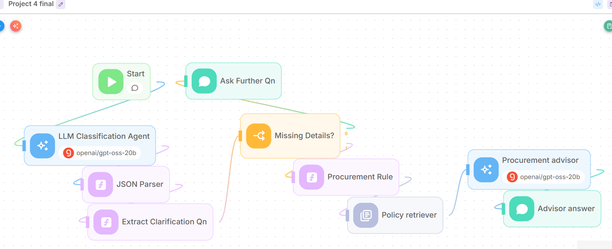

The workflow shown above has **two response paths**. The main path is **Start → LLM Classification Agent → JSON Parser → Extract Clarification Qn → Missing Details? → Procurement Rule → Policy retriever → Procurement advisor → Advisor answer**. If essential information is missing, the condition node routes the request to **Ask Further Qn**, which returns a clarification question to the user before the advisory path is run.

- **LLM Classification Agent:** I use **Groq `openai/gpt-oss-20b`** (temperature **0.1**) to extract eight structured fields, including question type, purchase category, amount, funding, payment method, exceptions and a clarification question. **Flowise’s built-in JSON Structured Output caused Groq tool-choice errors**: it expected a tool call rather than returning usable JSON. I therefore instructed the LLM to output **raw JSON text** and added a separate **JSON Parser Custom Function (JavaScript)** to parse and validate it. **Extract Clarification Qn** then passes the missing-information question to the **Missing Details?** condition, which decides whether to ask the user or continue. This avoids an extra LLM call and lets the rule engine use validated values.
- **State and routing:** Validated JSON is passed via Flow State (`classification`, `clarification_question`, `procurement_path`, `procurement_context`, `advisory_answer`). **JSON Parser** checks the data; **Extract Clarification Qn** and **Missing Details?** route incomplete requests to a follow-up instead of inventing facts. The full question is retained for retrieval and advice.
- **Deterministic rule engine:** The **Procurement Rule** JavaScript node determines the correct Section IV or V procurement path based on the extracted type and value. This reduces reliance on LLM reasoning for threshold comparisons such as **$10,000** for goods and **$50,000** for construction/professional services.
- **Policy-specific RAG:** The **Policy retriever** grounds answers in a structured Markdown knowledge base derived from the original **13-page purchasing-policy PDF**. Initially, retrieval mixed unrelated clauses or missed important requirements. Since I wanted to test how well a **free-tier LLM** could perform with better source preparation, I explored **PDF preprocessing and policy-aware chunking** rather than relying on a larger paid model. I use **Google Gemini `gemini-embedding-001`** for embeddings under its available free-tier allowance and **local FAISS** to avoid hosted vector-database costs. My retrieval settings are **Recursive Character Text Splitter, chunk size 1,800 characters, overlap 0, Top K 8**.

  **How I parsed the PDF:** I examined the original policy's numbered sections, **underlined subsection headings**, and clauses continuing across pages; extracted and cleaned the text; then reorganised it into **23 labelled policy topics** rather than one continuous document. Each topic includes a `POLICY_ID`, `SECTION`, `SCOPE`, a focused **plain-language paraphrase** that preserves thresholds and *MUST/MAY* conditions, plus `SOURCE` and `CITATIONS` linking to the **original PDF page**. I also inserted `<<<POLICY_RECORD_SPLIT>>>` markers to identify topic boundaries. For example, **Retainage**, **Change Orders**, **Bid Bond** and **Performance Bond** are distinct records even though they occur under Section V.B. I then previewed the actual Flowise chunks, rebuilt the FAISS index and tested whether the retrieved text included complete provisions and correct citations. These record boundaries are *logical*; the character splitter may still merge or divide records, so inspection remains important.

- **Procurement Advisory Agent:** A separate **Groq `openai/gpt-oss-20b`** LLM (temperature **0.1**) combines the user's question, validated classification, deterministic `procurement_path` and retrieved `procurement_context` to generate policy-grounded advice. After repeated errors across the five test questions, I revised its **system prompt to handle three response categories differently**: **(1) General policy questions** — answer only the specific provision asked about (e.g., retainage) without mixing in adjacent clauses; **(2) Procurement procedures** — provide the applicable category, threshold and mandatory steps in chronological order, including approvals and bidding requirements; **(3) YES/NO compliance questions** — start with **YES, NO or CONDITIONAL**, explain the restriction and suggest alternatives only when the policy supports them (e.g., purchasing-card limits). Across all categories, the prompt filters evidence into **directly relevant, supporting and irrelevant**, preserves **MUST versus MAY**, exact monetary amounts and responsible authorities, handles exceptions without inventing blanket waivers, and cites only the relevant **original PDF pages**. I also added a final self-check for completeness, unsupported claims and citation accuracy, plus concise formatting rules. These refinements, guided by **LLM-as-a-Judge**, helped a smaller free-tier model produce more accurate and focused answers.

## Challenges and resolutions

| Challenge | Resolution |
|---|---|
| **Groq HTTP 400: required tool call — structured-output/tool-choice errors:** I could not use Flowise's built-in JSON Structured Output with Groq because it kept expecting a tool call and returned HTTP 400 errors. | I changed the Classification Agent to return **raw JSON text** and used a **JavaScript Custom Function (JSON Parser)** to parse and validate it. I then extracted the clarification question into Flow State so the **Missing Details?** condition could route the request correctly. |
| **Retainage mixed with change orders:** The Advisory Agent repeatedly included change-order information when I asked about retainage. | I traced the problem to **retrieved chunks containing unrelated policy sections**. Since I was using a smaller free LLM, I wanted cleaner evidence rather than relying on the model to ignore irrelevant text. I converted the PDF into structured Markdown with separate subsection records, rebuilt the **FAISS** index and refined the advisory prompt. |
| **Construction chunk truncated the Mayor-execution requirement:** The last part of a long bidding provision was missing, even with **Top K 8**. | I inspected the actual retrieved context and found that the chunk ended before the Mayor-execution requirement. I increased the **chunk size from 1,500 to 1,800 characters**, kept zero overlap and rebuilt the FAISS index. This addressed a **chunk-completeness problem**, which increasing Top K alone could not fix. |
| **Missing related bidding clauses:** A construction question needed evidence from multiple sections covering bidding, approvals and bonds. | I increased **retriever Top K from 5 to 8** to bring back more relevant policy records, then checked the retrieved passages and the Advisory Agent's answer for missing or unrelated requirements. |
| **Advisory answers were repeatedly incomplete or inaccurate across the five test questions:** Even when classification was correct, repeated runs missed requirements or gave overconfident advice. The $75,000 bidding answer omitted Mayor execution, bond details or bid-award criteria; the purchasing-card answer incorrectly implied a purchase order was always required; emergency answers sometimes overstated waivers or presented paraphrases as exact policy quotations. | I used **GPT-6 as an LLM-as-a-Judge** to review accuracy, completeness, relevance and citations after each test. I then **iteratively refined the Advisory Agent's system prompt**, checking mandatory versus optional language (*MUST/MAY*), excluding unrelated rules, qualifying advice when purchase details were unknown and citing the original PDF. I also inspected `procurement_context` to distinguish **missing retrieval evidence** from **answer-generation errors**, reindexed where necessary and reran the five questions until the results improved. |

## Testing and screenshots

I tested five policy questions, alongside boundary-value, missing-information and off-topic cases. **ChatGPT GPT-6 (Medium)** acted as **LLM-as-a-Judge**, evaluating policy accuracy, completeness, relevance and citations to guide retrieval and prompt improvements. These are **qualitative estimated scores**, not official AISG grades.

| Test case | Flowise reply | LLM-as-a-Judge review | Judge score |
|---|---|---|---:|
| **1. $800 office supplies** — Section IV.A; supervisor approval and payment options. | 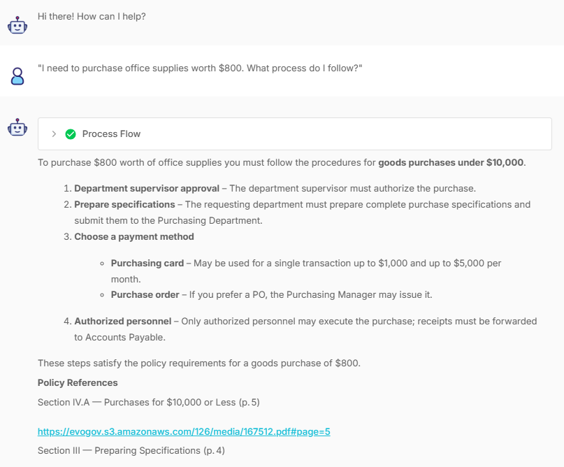 | 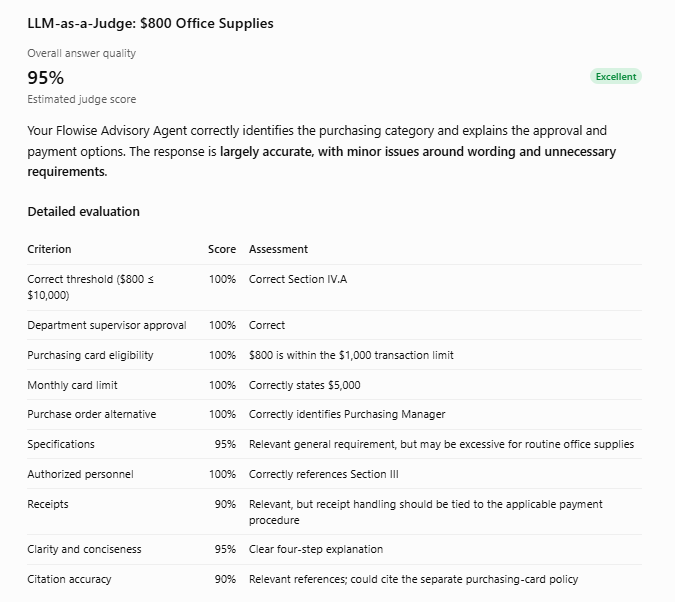 | **95%** |
| **2. $75,000 construction bidding** — Section V.B; sealed bids, Council approval and Mayor execution. | 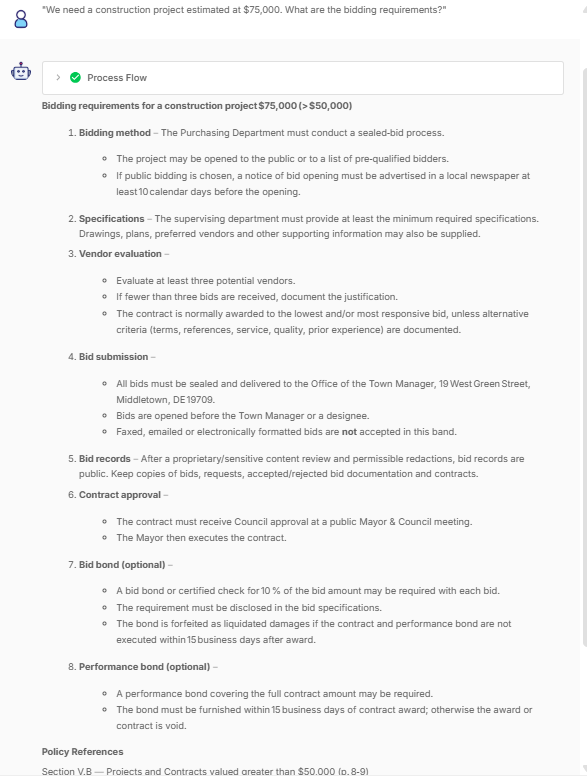 | 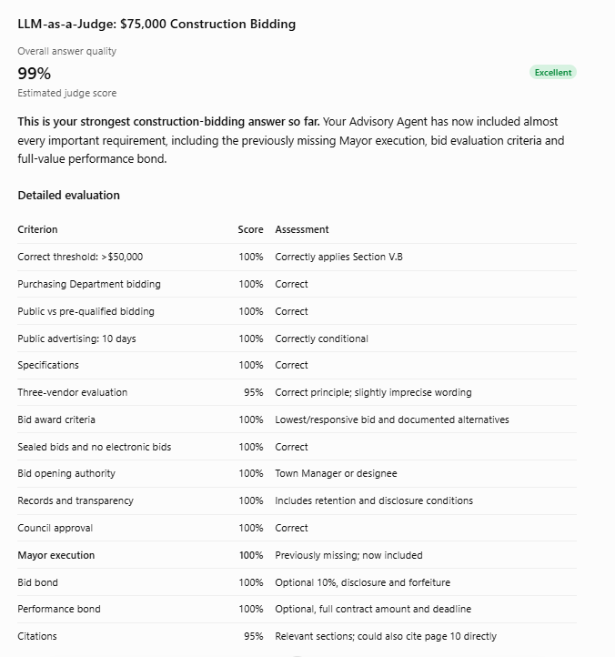 | **99%** |
| **3. $1,200 purchasing card** — Correctly rejects use above the $1,000 transaction limit; PO wording and citations could improve. | 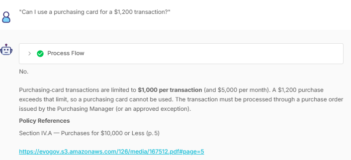 | 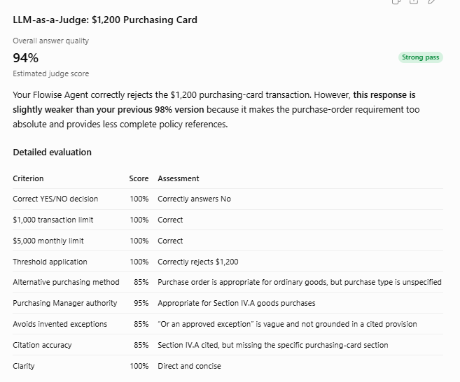 | **94%** |
| **4. Emergency purchase exceptions** — Distinguishes Sections VI.F and VI.E. | 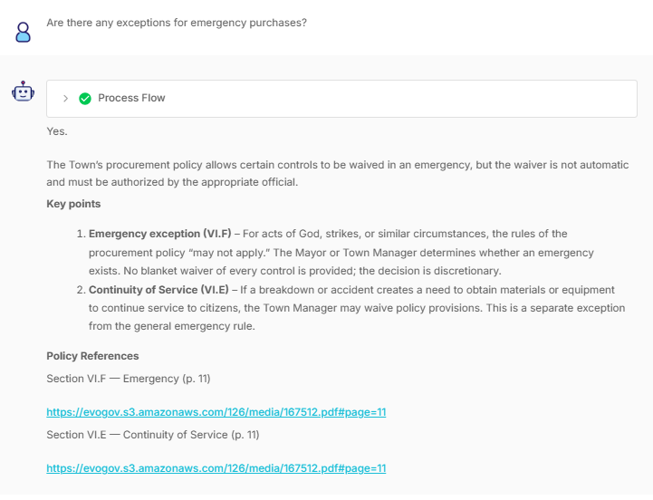 | 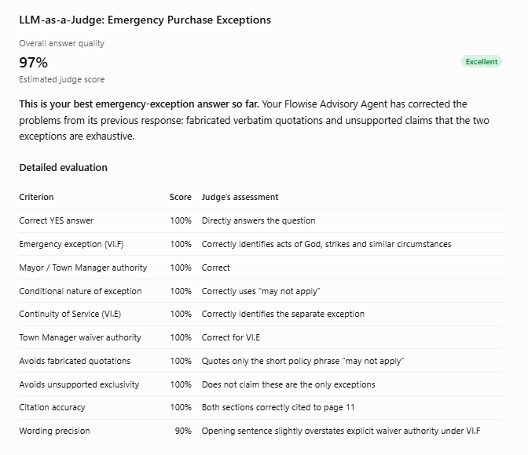 | **97%** |
| **5. Construction retainage policy** — Describes 10% initial retention, reduction to 5% and release on satisfactory completion. | 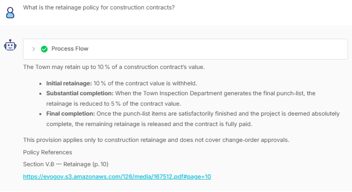 | 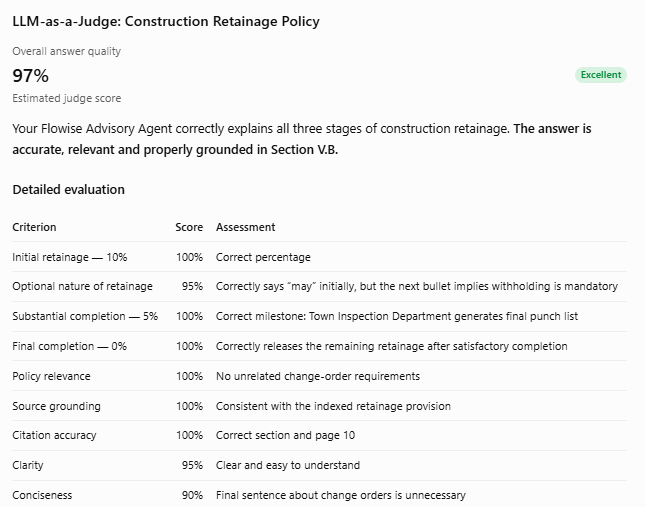 | **97%** |

**Additional validation (T06–T09): All passed.** I also tested the exact procurement threshold boundaries: **goods at $9,999 and $10,000 correctly followed Section IV.A, while $10,001 followed IV.B** (T06: [goods_1](images/goods_1.png), [goods_2](images/goods_2.png), [goods_3](images/goods_3.png)); **construction at $49,999 and $50,000 followed V.A, while $50,001 followed V.B** (T07: [construct_1](images/construct_1.png), [construct_2](images/construct_2.png), [construct_3](images/construct_3.png)). The workflow also passed the **missing-information test** by asking a targeted clarification question rather than assuming a value or category (T08: [missing_info_prompt](images/missing_info_prompt.png)), and the **negative/off-topic test** by not giving a procurement response to “What color is the sky?” (T09: [negative_test](images/negative_test.png)). **All T06–T09 results are in the local `images/` folder**, alongside the workflow and five reply/judge screenshot pairs.

## Conclusion

I learned a lot from this project, especially how to design a **multi-agent workflow** that combines a **Classification Agent**, **Retrieval-Augmented Generation (RAG)** and a **Procurement Advisory Agent**. Using free-tier models and tools was more challenging than I expected, particularly when handling structured outputs, retrieving relevant policy evidence and improving answer accuracy. However, these limitations pushed me to experiment with different approaches, troubleshoot the workflow and learn much more through hands-on testing. **Thank you, AI Singapore, for giving me this opportunity to learn and apply these skills.**
